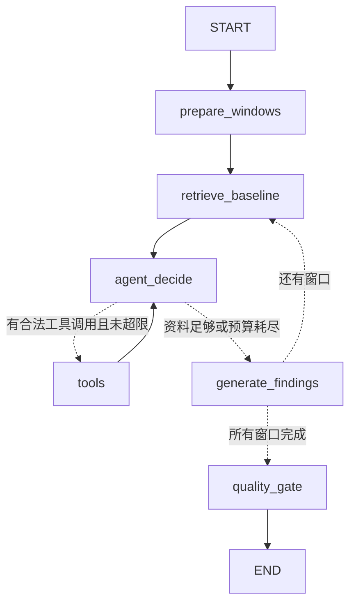

# P4 架构优化：LangGraph Contract Review Agent

本轮在已完成的 P4.8 上重构审查执行，不重写 Document Intelligence、RAG 算法、ORM 或前端。验收日期：2026-10-10。Prompt 为 `review-v2-graph-v1`，Graph 为 `review-graph-v1`，Quality Gate 仍为 `review-quality-v1`，数据库 head 仍为 `0008_contract_knowledge`。没有进入 P5，也没有自动 Git Commit。

## 1. 重构前的可读性问题

原 `review_agent.py` 同时负责窗口切片、提示词、模型调用、校验重试和结果累积；`run_contract_review` 又包含检索缓存、两个异步回调、`nonlocal review_context`、引用快照和失败 Trace 更新。实际审查顺序藏在循环与闭包中，新增只读资料工具必须同时理解 Agent、Workflow 和数据库副作用。

这次把执行顺序写成真正的 StateGraph，把数据准备与模型自主补充资料区分开。没有新增 Service / Store / Repository / Port，也没有把 Parser、检索算法、数据库变成 Agent。

## 2. 最终目录与入口

```text
products/contract/
├── api.py                         # 原有 HTTP 接口，接口协议不变
├── models.py                      # 原有 ORM，本轮无新增表
├── db.py                          # 共享事务、来源签发、最终门禁和发布
├── quality.py                     # 普通 Python 确定性校验
├── retrieval.py                   # 原 Hybrid RAG 算法，不重写
├── document/contract_jobs.py       # 后台依赖组装
├── document_intelligence/         # 原 Facts 流程，不改成 Graph
├── workflows/review_workflow.py    # 领取 → Facts → Graph → 原子发布
└── agents/review/
    ├── __init__.py                 # 唯一 ReviewAgent.review 入口
    ├── graph.py                    # 节点和条件边
    ├── state.py                    # State / Runtime / Limits / Result 数据类型
    ├── nodes.py                    # 窗口审查阶段与资料合并
    ├── windows.py                  # 既有完整覆盖的切片/分窗算法
    ├── tools.py                    # 两个只读工具和请求内查询缓存
    ├── llm.py                      # 决策调用与结构化输出调用
    └── prompts.py                  # 两类模型提示词
```

旧 `agents/review_agent.py` 已移除；调用方、测试与脚本均改用新入口，不保留平行实现。

上传/重新分析仍从 `api.py` 派发后台任务，进入 `document/contract_jobs.execute_analysis`：它组装 `DocumentIntelligencePipeline` 和 `ReviewAgent(retrieval_factory=SessionLocal)`，再调用 Workflow。不是在 HTTP 接口里持有事务执行模型。

## 3. 实际节点与条件边

下图按编译后的 `build_review_graph().get_graph().draw_mermaid()` 的节点与边整理，只省略显示样式：



- `prepare_windows`：验证当前 Version/Policy 范围，生成原文不丢失的审查窗口。
- `retrieve_baseline`：每个窗口必经，调用既有 RAG，按预算放入真实参考片段，重置该窗口工具轮数与消息。
- `agent_decide`：首先接收上轮 ToolMessage 资料，再让模型判断是否需要补充；预算检查不替模型决定查询词。
- `tools`：真正的 LangGraph `ToolNode`，执行 AIMessage 中的 tool_calls。
- `generate_findings`：单独调用 Structured Output，逐窗口验证后累积 RiskFinding，不把决策文本解析成风险。
- `quality_gate`：全量确定性校验和保守去重，返回报告；数据库发布还有一道权威门禁。

只有 `agent_decide` 和 `generate_findings` 调用 LLM。工具本身不是新的 Agent。

## 4. ReviewState 与调用结果

| 字段 | 用途 |
|---|---|
| `version_id`、`user_id` | 服务端确定的版本和权限边界，模型不能指定 |
| `our_party`、`party_role`、`contract_type` | 用户明确填写的审查立场，不从客户名称猜测 |
| `clauses`、`metadata` | 已发布的 Canonical Clause / Facts，不由 Review 重新提取 |
| `policies` | 本次 Run 开始审查前冻结的适用企业规则 |
| `windows`、`window_index` | 所有审查窗口与当前进度 |
| `current_window` | 当前真正送入模型的目标条款、关联条款、Policy 和 RAG 片段 |
| `current_references` | 当前窗口实际提供的来源及原文前缀，而不是所有召回结果 |
| `messages` | 当前窗口 AIMessage / ToolMessage 协议，使用 add_messages reducer |
| `tool_rounds`、`tool_count` | 当前窗口的补充轮数与调用数 |
| `processed_tool_ids`、`tools_pending` | 防止重复消费结果，决定是否走 ToolNode |
| `findings` | 各窗口原始风险，保留重复项供最终审计 |
| `used_references` | 多窗口实际提供的来源合集，合并条款范围及最长已提供前缀 |
| `retrieval_events` | 基础/补充检索诊断、缓存命中、召回数量和耗时 |
| `result`、`quality_report` | Graph 门禁输出及去重说明 |

State 不存数据库 Session、LLM、OSS 或 Embedding 客户端。`ReviewRuntime` 是每次调用新建的运行依赖，放在 Graph context 中，包含模型适配器、Session factory、查询缓存/锁和 Trace，不做 checkpoint，也不把客户端存进 PostgreSQL。

返回 `ReviewGraphResult`：`result`、`used_references`、`retrieval_events`、`review_trace`、`quality_report` 和 `raw_findings`。`publication_result` 保留去重前输出，让数据库 Gate 仍能记录原始重复风险的审计信息。没有共享的 `reviewer.trace`，同一个 Agent 并发调用也不串用户、缓存或 Trace。

## 5. 固定流程与 ReAct 的边界

固定流程负责：任务领取、Facts 复用、规则冻结、完整分窗、每窗基础 RAG、结构化生成、校验和发布。模型不能跳过这些步骤。

ReAct 只负责：在已有窗口资料上决定是否调用只读工具、选哪个工具、输入什么业务查询。工具后重新进入决策节点，模型看到补充的真实来源后再判断是否足够。

默认每窗口最多 **2 轮 / 4 次工具调用**；每次检索（含等待共享缓存锁）最多 30 秒，模型调用最多 90 秒，整次 Graph 默认 240 秒，递归上限 512 步。超出轮数/调用/历史上下文预算后，用已提供资料进入结构化生成；服务故障、非法 ID、伪造参数则明确失败，不冒充成功检索。

数据窗口预算延续 **24,000 字符**；ReAct 给工具消息预留 3,000 字符，原文切片覆盖不减少。系统提示与工具 Schema 是固定额外开销，并非“24k Token”承诺；实际 Token 另记 Trace。工具原文只打包一次，ToolMessage 保留来源 ID 回执，防止重复堆叠整段资料。

`.env.example` 增加 `CONTRACT_REVIEW_REACT_ENABLED`、`CONTRACT_REVIEW_MAX_TOOL_ROUNDS`、`CONTRACT_REVIEW_MAX_TOOL_CALLS`、`CONTRACT_REVIEW_TOOL_TIMEOUT`。明确设为 `false` 时运行固定 Graph，保留基础 RAG、Structured Output 和 Gate；不会静默把不支持工具的模型假装成 ReAct。

## 6. 工具与真实调用机制

| 工具 | 模型可传参数 | 服务端边界 |
|---|---|---|
| `search_knowledge` | `query`，2–500 字符 | 从 ToolRuntime 取当前 user_id，复用当前用户私有知识库检索 |
| `get_related_clauses` | `clause_types`，1–4 个限定类型 | 只读 State 中当前 Version 的条款；最多 4 条、6,000 字符，单条最多 4,000 字符 |

没有 user_id、version_id、SQL、文件路径、数据库写入或正式修改参数。调用机制是 `bind_tools(..., tool_choice="auto")` → 真实 `AIMessage.tool_calls` → 名称/参数白名单与 ID 检查 → `ToolNode` → `ToolMessage` → 再次模型决策。

Pydantic 工具 Schema 忽略 ToolNode 注入的隐藏 runtime；模型原始参数在注入前已经严格按公开参数白名单拒绝。不能靠伪造 `runtime` 绕过鉴权。知识库返回来源在送入后续模型前验证 owner/ID；关联条款不接收目标版本。文档中的指令只是数据，不能增加工具能力。

以后新增只读工具：在同一 `tools.py` 定义有界参数和只读函数，使用隐藏 ToolRuntime 的服务端范围，加入 `REVIEW_TOOLS`；若有新资料类型，再为 `collect_tool_results` 增加有预算、可验证的资料合并，并补权限/超时/来源/模型协议测试。不要新增通用 SQL 工具或重建 Service/Port 层。

## 7. 基础 RAG 与补充 RAG

基础：`retrieve_baseline → clause_query → search_references → retrieval.retrieve_references`。

补充：`agent_decide → AIMessage.search_knowledge → ToolNode → search_references → 同一 retrieval.retrieve_references`。

底层继续是当前用户 Ready 文档 → pgvector dense + BM25 → RRF → 真实 Rerank → 文档状态/版本复核。缓存只存在本次 Review，按规范化 Query 命中，不能跨用户复用。空知识库/空结果明确返回空来源；原有检索故障处理和数量限制保留。

工具资料经 `collect_tool_results` 放入 `current_window.references/context_clauses`，下一次决策和最终生成都能读到原文。超预算没有放入模型的来源，不进入 `used_references`，也不能作为有效 citation。召回诊断数量与实际提供数量可能不同，窗口 Trace 的 chunk_ids 记录后者。

## 8. Workflow 简化前后

本次开始时 `run_contract_review` 为 **183 行**，重构后为 **75 行**（包含签名、空行和注释）。旧文件中的 V1 校验兼容函数保留，不算本次 Graph 的第二套实现。

之前的核心形态：

```python
cached_queries = {}
async def retrieve(targets):
    # 查询构造、缓存、检索诊断藏在 Workflow 内
    ...
async def record_references(references, clause_ids):
    nonlocal review_context
    async with session.begin():
        review_context = await db.record_review_references(...)
result = await reviewer.review(..., retrieve=retrieve,
                               record_references=record_references)
# Workflow 再读取 reviewer.trace，自己更新失败诊断
```

现在的核心形态（省略参数）：

```python
# 短事务：领取任务、准备 Facts、冻结 Policy、标记 analyzing
output = await reviewer.review(facts.clauses, user_id=context.user_id, ...)
# Graph 内没有业务发布事务
async with session.begin():
    for reference in output.used_references:
        await db.record_review_references(
            session, context, [reference], reference["clause_ids"])
    await db.complete_run(session, context, output.publication_result,
                          review_trace=output.review_trace,
                          retrieval_events=output.retrieval_events)
```

失败时先回滚，再调用 `db.fail_run` 条件更新失败状态/Trace；只有仍在运行的 Run 才能更新，已完成 Run 不被迟到异常覆盖。没有通过回调隐藏来源保存。

## 9. Policy 与 RAG 快照如何保存

Policy 在审查前由 `prepare_review_context` 按所有者、启用状态和适用角色/合同类型冻结到 Run，后续规则修改不会改变当次输入。

RAG 来源由 Graph 明确返回。发布事务中，`record_review_references` 用真实 Chunk/Document 再检查 owner、文档版本、generation、文件名、类别和原文，然后保存实际提供的片段及 clause_ids；随后 `complete_run` 使用这些快照验证每个 RiskFinding。不是拿模型自己返回的文档名当可信来源。

引用快照、风险、Run completed 和当前展示指针同事务提交。最后一刻来源被删除/换代则安全失败，不发布不可信结果。成功后的快照不依赖知识库仍然存在；资料重建或删除后，历史详情仍返回原版本和原片段。已完成 Run 的相同重复发布不覆盖快照，新内容不能覆盖旧结果。

## 10. 数据库与 Quality Gate 兼容

本轮不新增表、迁移、前端字段或修改 API 路径。保留 V1 历史，V2 重新分析复用已发布 Facts。

每窗结构化生成最多尝试两次，反馈 Schema/证据/规则/引用错误；模型服务超时不误判成 Schema 错误重试。Graph 汇总门禁负责跨窗口去重；`db.complete_run` 再以持久化 Canonical Clause、Policy/RAG 快照做权威验证，绕过 Graph 的伪造输出仍不能发布。

所有来源发布/完成/失败事务统一按 **Version → Run** 取锁。保留原子 claim、重复完成幂等、同条款多风险、跨条款引用、原文归一化定位和迟到失败保护。DI 和 LLM/工具网络请求不跨持有业务事务。

## 11. 实际测试与性能记录

环境：既有 `.venv-py312`，Python 3.12.10；本地 LangGraph 1.1.10 / prebuilt 1.0.13。Docker PostgreSQL 启动后补完真实验收，不用 Mock 替代数据库/外部模型通过结论。

### 自动化与真实集成分开报告

| 检查 | 本轮结果 / 范围 |
|---|---|
| 重构前 `pytest tests/contract tests/common -q` | 167 passed，保留原 P4 基线 |
| 最终相同后端命令 | **197 passed**；新增 30 项 Graph/ToolNode/预算/并发/原子快照测试；模型与检索响应在单元测试中明确模拟，SQLite 事务与 Gate 为真实实现 |
| `npm run test:contract` | **21 passed**；真实 Edge/React，API 使用模拟数据，含 Token 过期、V1/V2、来源与移动端 |
| `npm run build` | 通过，TypeScript + Vite，3,350 modules |
| 合同线 / 公共 HTTP / 浏览器测试 ESLint | 通过，0 错误/警告 |
| 全项目 `npm run lint` | **未通过**；Interview ChatPage / ChatInput / stream 存量 3 错误、2 警告，本轮未修改这些文件 |
| `scripts.contract.test_contract_migration_postgres` | 临时 PostgreSQL upgrade/audit/downgrade/re-upgrade/check 通过并清理 |
| `scripts.contract.test_document_facts_concurrency` | 真实 PostgreSQL Facts、并发领取、重复发布、来源快照与迟到失败锁竞争通过并清理；模型/来源向量为明确的合成 fixture |
| `scripts.contract.test_contract_demo_live --mock-review` | 真实业务库/OSS/PDF/DOCX/API、并发版本、重试、历史/Facts 隔离通过；DI/Review 明确模拟；虚构记录与原件已清理 |
| `scripts.contract.test_contract_knowledge_live --review` | 重构前后各通过一次真实全链路；OSS、PDF/DOCX、DI、Embedding、pgvector/BM25/RRF/Rerank、Review 模型、Gate、PG 发布和来源 API 均真实，临时库/原件清理 |
| 本地业务库 `alembic check` / schema audit | 通过，无 schema 漂移，audit issues/warnings/data 异常为空 |
| `compileall` / `git diff --check` | 通过；Git 提示 LF/CRLF 转换，不是补丁错误 |

Graph 专项包含不调用工具、调用两个只读工具、工具后模型继续、两轮停止、缓存、空结果、非法参数/版本/用户/ID、故障与超时、调用/上下文/递归预算、多窗口、跨用户并发缓存隔离、引用与报告原子回滚、重复发布和已完成 Run 不被失败覆盖。原有规则/引用伪造、证据、V1、Facts、历史、跨条款测试继续保留。

真实链路先执行 DOCX 无工具审查，再修改 Policy/重建索引并重新审查，验证真实补充 Tool Calling、Facts 不变；删除知识库后回看旧报告，再执行 PDF 全链路及跨用户 404。两个 DOCX 路径仅在验收脚本临时追加决策指引，以稳定覆盖“不需要工具”与“额外检索”分支；生产提示未强制调用，`tool_choice` 始终为 auto。工具名称、查询参数和调用消息由真实模型生成，没有伪造 AIMessage、直接 Python 代调工具或模拟检索结果。PDF 使用未经覆盖的生产决策提示。

### 同一虚构合同的有限样例对比

| 指标 | 重构前固定流程 | 新 Graph：无补充工具 | 新 Graph：补充检索 |
|---|---:|---:|---:|
| Facts Coverage | 100% | 100% | 100%（复用同一 Facts） |
| 有效 RiskFinding / 输入数 | 3/3 | 3/3 | 3/3 |
| 发布的无效来源引用 | 0 | 0 | 0 |
| Review 模型调用 | 1 | 2 | 3 |
| 补充工具调用 | 0 | 0 | 1，search_knowledge，返回 3 个来源 |
| 上传至报告可读取 | 40.036s | 54.595s | 不适用，重新分析复用 Facts |
| Graph 自身耗时 | 旧 Trace 未记录同口径 | 36.462s | 22.202s；重新分析端到端 22.762s |
| Review 模型 total_tokens | 旧 Trace 未采集 | 7,430 | 8,549 |

新无工具路径比原来多一次真实资料决策；补充路径再增加一次工具后决策，不是图调度凭空重复生成风险。本次无工具上传耗时增加约 36%，包含一次额外模型调用、DI 和外部网络波动；补充路径耗时较短不能推断“工具使系统更快”。这些是一次 smoke 的实测值，不是性能基准或吞吐承诺。若需要旧固定调用成本，可显式关闭 ReAct；不暗中跳过模型工具决策。

模型服务返回的标识为 `gemini-3.7-flash`。Token 来自实际响应 usage（只统计 Review；不含 DI、Embedding、Rerank 或供应商未上报的内部重试）。旧实现没有记录同口径 Token，且没有计费账单/该服务价格，因此不虚构旧 Token 或 API 金额。

以上“有效”指协议和来源门禁，不是法律判断正确率。**真实法律审查质量评估未执行**：没有标注法律基准、专家盲审或风险召回率测试，不能用三条有效来源风险声称法律准确率 100%。

## 12. 未解决问题与范围限制

- 本轮验证有限的真实模型样例，不保证所有工具模型供应商、超长合同、所有风险召回和商业推理均正确。
- 跨条款补充受窗口/类型/数量预算约束，不做全部条款关系的穷尽搜索；来源门禁不能替代法务判断。
- 没有新增 Checkpointer、interrupt/resume、持久化 MQ 或宕机恢复；仍沿用现有后台任务。长文档/高并发成本和生产服务器部署需要专门验收。
- 模型调用轮数与字符预算可控；不是精确 Token 硬限额。超时会中止当前审查，底层网络线程取消能力仍由原客户端决定。
- 知识库仍为当前用户私有，不新增组织共享权限；本轮未改 Interview 或其他产品线。
- 全项目前端 ESLint 仍有面试线存量问题；不能把合同专项通过描述成“整个仓库所有检查都通过”。
- P5 Revision 应使用独立的正式修改/审批流程；本 Graph 只产生待确认风险和建议，不能输出 ContractChange、修改合同、导出或发邮件。

## 13. 验收结论与复跑

本轮 Review Graph 工程验收已完成：真实 StateGraph/ToolNode、固定基础 RAG、有界模型工具决策、来源可追溯、数据库二次门禁、原子提交、历史兼容及真实模型两条路径均有实测。法律质量全面评估、上线与 P5 不在该结论内。

后端目录运行：

```powershell
.\.venv-py312\Scripts\python.exe -m pytest tests/contract tests/common -q
.\.venv-py312\Scripts\python.exe -m scripts.contract.test_contract_migration_postgres
.\.venv-py312\Scripts\python.exe -m scripts.contract.test_document_facts_concurrency
.\.venv-py312\Scripts\python.exe -m scripts.contract.test_contract_demo_live --mock-review
.\.venv-py312\Scripts\python.exe -m scripts.contract.test_contract_knowledge_live --review
.\.venv-py312\Scripts\python.exe -m alembic check
.\.venv-py312\Scripts\python.exe -m scripts.contract.audit_contract_schema
```

前端目录运行 `npm run test:contract`、`npm run build`。外部全链路脚本会调用已配置的真实模型/OSS，产生相应服务用量；使用虚构 fixture，自动清理其临时数据库或测试记录/对象。
